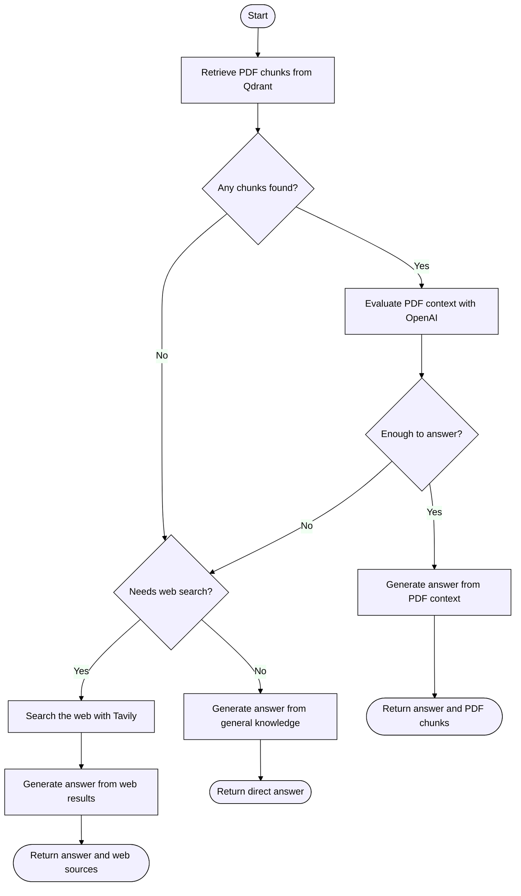

# PDF RAG Chatbot

An Express API for chatting with OpenAI, Gemini, or a local Ollama model. Uploaded PDFs are split into searchable chunks and stored in Qdrant Cloud. For each chat request, the LangGraph workflow tries the PDF store first, evaluates whether retrieved passages answer the question, then routes unanswered questions either to Tavily web search or directly to the chat model when general knowledge is sufficient.

## Requirements

- Node.js 22.13 or newer is recommended.
- API keys for the providers you plan to use:
  - `OPENAI_API_KEY` for OpenAI chat and PDF-context evaluation.
  - `GOOGLE_API_KEY` for Gemini chat.
  - Ollama installed and running locally for Ollama chat; no API key is required.
  - `TAVILY_API_KEY` for web-search fallback.
  - `QDRANT_URL` and `QDRANT_API_KEY` for Qdrant Cloud vector storage.
  - `LANGSMITH_API_KEY` to send traces to LangSmith (optional).

## Setup

1. Install the dependencies:

   ```sh
   npm install
   ```

2. Copy `.env.example` to `.env` in the project root, then set the keys you need. In PowerShell:

   ```powershell
   Copy-Item .env.example .env
   ```

   Leave out provider keys you do not use. Set `QDRANT_URL` and `QDRANT_API_KEY` from your Qdrant Cloud cluster, and optionally set `QDRANT_COLLECTION`. To use Ollama, start its local service and pull the default model with `ollama pull llama3.2:3b`; you can set `OLLAMA_CHAT_MODEL` to a different installed model. `TAVILY_API_KEY` is required when the graph needs web search. Confirm that configured model IDs are available to your provider account.

   LangSmith tracing is enabled by `LANGSMITH_TRACING=true`. Set `LANGSMITH_API_KEY` to your LangSmith API key and choose a `LANGSMITH_PROJECT` name; traces are then sent automatically by LangChain. `LANGSMITH_ENDPOINT` is optional and is only needed for a non-default LangSmith region. Use the API endpoint (for example, `https://apac.api.smith.langchain.com` for APAC), not the LangSmith web-app host. Without an API key, LangSmith tracing will not be available.

3. If you have existing vectors in LanceDB, migrate the active table before starting the API:

   ```sh
   npm run migrate:lancedb
   ```

   `LANCEDB_PATH` and `LANCEDB_TABLE` select the source, defaulting to `./lancedb_data` and `pdf_documents_hf_minilm`. The source vectors must have the same dimensions as `HUGGINGFACE_EMBEDDING_MODEL`; the migration preserves their embeddings and page metadata. The script can be rerun safely. Keep the LanceDB files until you have verified the migrated collection.

4. Start the server:

   ```sh
   npm start
   ```

   The server listens on port `3000` by default, or the port specified by `PORT`.

5. To bundle the application source:

   ```sh
   npm run build
   node dist/index.js
   ```

   The bundle is written to `dist/index.js`. Runtime dependencies remain external, so install production dependencies and run the command from the project root (where `.env` is located).

Keep `.env` private and do not commit API keys.

### LangSmith

After starting the server with LangSmith configured, send a chat request and open the configured project in LangSmith to inspect the trace, including the graph and its model calls. The trace may contain user prompts, conversation history, retrieved PDF excerpts, and model outputs; use an appropriately access-controlled project and avoid sending sensitive data if that is not acceptable.

## API

### `POST /upload`

Ingest a PDF into the configured Qdrant collection. The file can be sent as multipart form data in the `file` field:

```sh
curl -X POST http://localhost:3000/upload \
  -F "file=@./document.pdf"
```

The endpoint also accepts the raw PDF as the request body; optionally provide its name with the `x-filename` header. Uploads are limited to 20 MB. The response includes the filename, page and chunk counts, and Qdrant collection name.

Ingestion extracts PDF pages, splits their text into chunks of 1,000 characters with 200 characters of overlap, creates local Hugging Face embeddings, and writes the chunks and source/page metadata to Qdrant. The embedding model is downloaded on first use. Configure the Qdrant Cloud endpoint, API key, and collection with `QDRANT_URL`, `QDRANT_API_KEY`, and `QDRANT_COLLECTION`. The API creates keyword and integer payload indexes for `metadata.source` and `metadata.pageNumber` on existing and new collections so page expansion filters work.

Completed chat exchanges are stored in SQLite in the `chat_messages` table. Each exchange saves the user's message and the assistant's final answer together. The latest 20 messages for a thread are loaded as context for later requests, including after a server restart. The database defaults to `./chat_history.sqlite` and can be relocated with `CHAT_HISTORY_DB_PATH`.

Chat queries, extracted PDF text, and PDF filenames are redacted for common email, phone, government-ID, payment-card, medical-ID, date-of-birth, labeled name, and labeled address patterns before model use or persistence. Existing chat-history entries are redacted when loaded and updated in SQLite. This pattern-based filtering is a safeguard, not complete PHI detection or a guarantee of HIPAA compliance; review redacted output and do not send data that must not be processed.

### `POST /chat`

Send a JSON request with a non-empty `query`. The optional `model` can be `openai`, `gemini`, `ollama`, a `gpt-*` model ID, or a `gemini-*` model ID. Selecting `ollama` uses `llama3.2:3b` by default, or the model configured in `OLLAMA_CHAT_MODEL`. The API returns a `threadId` and also stores it in an HTTP-only cookie so browser/API clients that retain cookies can continue the same conversation without sending the ID each time. To select a conversation explicitly, send the `threadId` returned by a previous response.

```sh
curl -N -b chat-cookies.txt -c chat-cookies.txt \
  -X POST http://localhost:3000/chat \
  -H "Content-Type: application/json" \
  -d "{\"query\":\"What does the document say about compliance?\",\"model\":\"openai\"}"
```

If `model` is omitted, the server uses `DEFAULT_CHAT_MODEL`. The endpoint responds with Server-Sent Events: after the model finishes generating, a `token` event contains the full answer, followed by a `complete` event containing the full `answer`, selected `model`, `threadId`, and `contextMode` (`pdf`, `web`, or `llm`). PDF-grounded completions include `chunks` with source and page details; web-grounded completions include Tavily `sources`. An `error` event is sent if processing fails after the response begins.

## Request flow

The chat graph retrieves candidate chunks from Qdrant. If there are matches, the graph expands them to their full indexed PDF pages and asks an OpenAI evaluator whether the PDF context answers the query. Sufficient context goes to answer generation. Otherwise, explicit web-search requests and clearly time-sensitive topics such as weather, temperatures, current prices, and latest news route directly to Tavily; the selected chat model classifies other queries. General questions go directly to the model. The selected OpenAI, Gemini, or Ollama chat model generates the final answer from the chosen context and conversation history.



The same graph is available as a standalone [Mermaid chart](./langgraph.mmd).

## MVC layout

| Path | Responsibility |
| --- | --- |
| `index.js` | Loads environment variables and starts the HTTP server. |
| `src/app.js` | Configures Express middleware, routes, and error handling. |
| `src/routes/chat.routes.js` | Defines the `/chat` and `/upload` endpoints and PDF body parsing. |
| `src/controllers/chat.controller.js` | Validates requests, invokes services, and formats responses. |
| `src/services/pdfIngestion.service.js` | Loads, splits, and ingests PDF pages. |
| `src/services/chatGraph.service.js` | Builds the LangGraph workflow and selects chat models. |
| `src/models/vectorStore.model.js` | Connects to Qdrant and configures embeddings and page expansion. |
| `src/scripts/migrateLanceDbToQdrant.js` | Migrates the configured LanceDB table into Qdrant Cloud. |
| `src/models/chatHistory.model.js` | Stores completed user/assistant exchanges and loads recent conversation history from SQLite. |
| `src/middleware/errorHandler.js` | Converts request errors into HTTP responses. |

## Notes

- LanceDB is used only as a migration source; the application stores and searches PDF vectors in Qdrant Cloud.
- Chat history is persisted per `threadId` in SQLite. The HTTP-only `chat_thread_id` cookie lasts seven days; clients that do not retain cookies should send the returned `threadId` on each request. The SQLite database contains conversation content, so protect its file and backups as sensitive data.
- The document-sufficiency check always uses OpenAI when PDF chunks are retrieved, regardless of the answer model. `OPENAI_API_KEY` is required for this evaluation even if Gemini is selected for answer generation.
